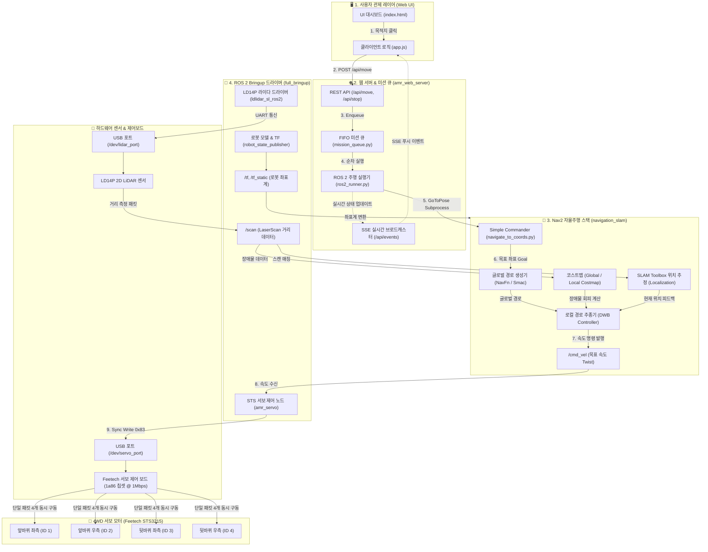

# 🤖 AMR 자율주행 시스템 & 하드웨어 통합 아키텍처 다이어그램

본 문서는 **물리적 하드웨어 센서/액추에이터**부터 **`amr_bringup` 드라이버 레이어**, **Nav2 자율주행 스택**, **웹 관제 서버 및 프론트엔드 UI**까지의 데이터 흐름을 한눈에 보여줍니다.

---

## 🏗️ 전체 하드웨어 & 소프트웨어 데이터 흐름도

---

## 📌 하드웨어와 소프트웨어 간의 주요 인터페이스 요약

| 하드웨어 장치 | 연결 포트 | 담당 ROS 2 노드 | 통신 프로토콜 / 토픽 |
| :--- | :--- | :--- | :--- |
| **📡 LD14P 2D 라이다** | `/dev/lidar_port` (CP2102) | `ldlidar_sl_ros2` | 230,400 bps 시리얼 ➔ **/scan** (LaserScan) |
| **🎛️ STS3215 서보 제어보드** | `/dev/servo_port` (1a86) | `amr_servo (sts_controller)` | 1,000,000 bps 시리얼 ➔ **Sync Write (`0x83`)** |
| **🛞 4개 STS3215 모터** | Daisy-Chain Bus | `amr_servo` | ID 1(좌앞), ID 2(우앞), ID 3(좌뒤), ID 4(우뒤) |
| **🤖 로봇 프레임 (Chassis)** | - | `robot_state_publisher` | URDF ➔ **/tf** (`base_footprint` ➔ `base_link` ➔ `laser_frame`) |
