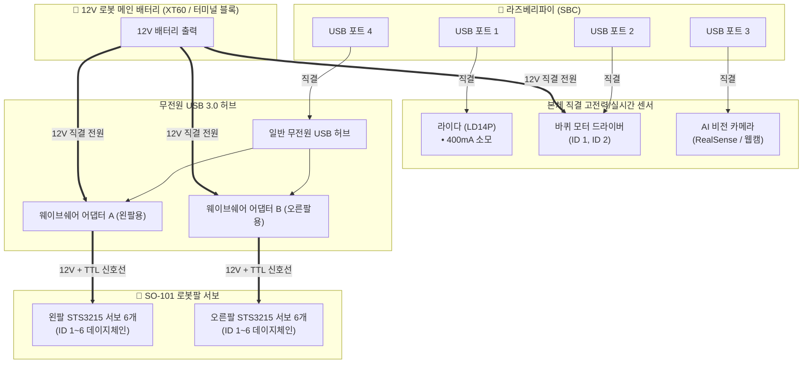
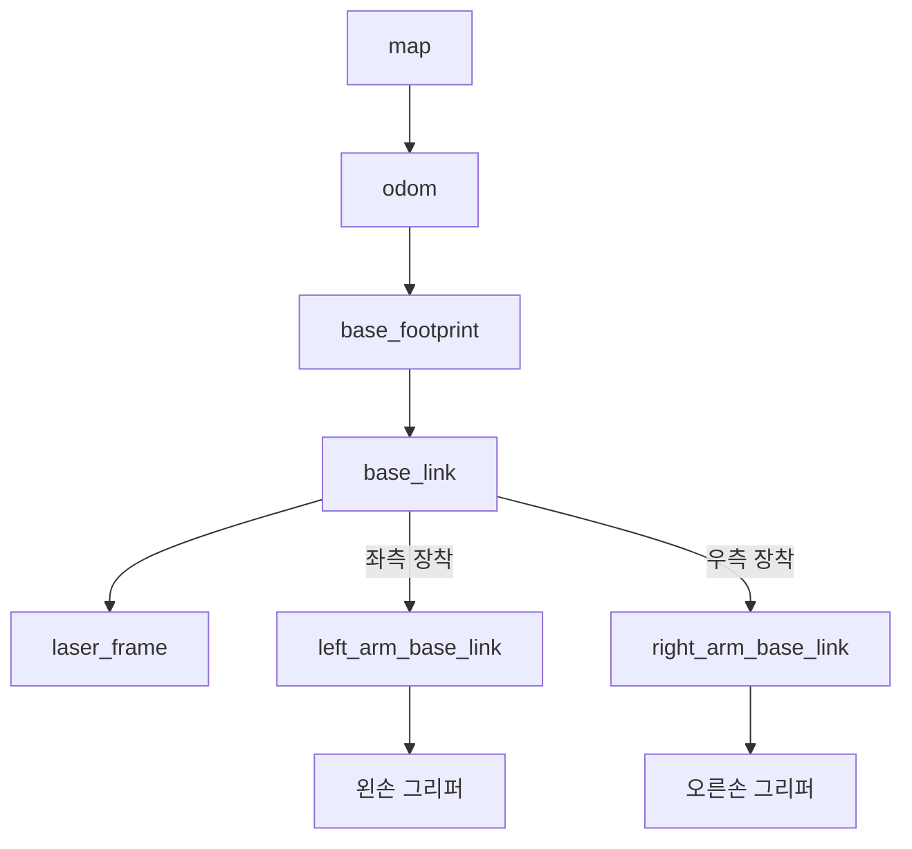

# 🦾 AMR + SO-101 양팔 로봇(Dual-Arm) 연동 통합 구축 가이드

---

## 1. 개요 (System Overview)

본 문서는 자율이동로봇(AMR) 상판에 **SO-101 6축 로봇팔 2대(왼팔, 오른팔)**를 장착하여 **양팔 모바일 매니퓰레이터(Bimanual Mobile Manipulator)**를 구축하기 위한 하드웨어 배선, 전원 설계, USB 포트 구성, udev 포트 고정, URDF 결합 및 소프트웨어 제어 파이프라인을 체계적으로 정리한 실전 가이드입니다.

---

## 2. 하드웨어 및 배선 아키텍처 (Wiring & Power)

### (1) 전원 분리 원리 (12V 모터 vs 5V 논리 전원)
Feetech STS3215 스마트 서보는 모터 구동 전원(12V)과 시리얼 통신 논리 전원(5V/3.3V)이 완전히 분리되어 있습니다.
* **12V 대전류:** 모터가 회전하고 토크를 낼 때 필요한 전류(서보 1개당 최대 1.5A~2A)는 **12V 배터리**에서 직접 공급받습니다.
* **USB 5V 소전류:** USB 케이블로는 오직 어댑터 보드의 통신 칩(CH343 등)을 켜는 **20~30mA의 극소량 논리 전류**만 흐릅니다.

> [!TIP]
> 따라서 **웨이브쉐어 어댑터에 12V 전원을 직결하면, 무전원 USB 허브를 사용해도 라즈베리파이에 전류 과부하가 전혀 발생하지 않습니다.**

---

### (2) 최적 USB 포트 및 전원 결선도



---

## 3. 시리얼 포트 고정 (udev Rules)

장치가 여러 개 연결되면 재부팅할 때마다 `/dev/ttyUSB0`, `/dev/ttyUSB1`, `/dev/ttyACM0` 번호가 뒤바뀔 수 있습니다. 고유 식별자(ID)를 이용해 고유 심볼릭 링크를 생성합니다.

### (1) udev 규칙 파일 생성
로봇 SBC에서 `/etc/udev/rules.d/99-amr-manipulator.rules` 파일을 생성합니다:

```bash
sudo nano /etc/udev/rules.d/99-amr-manipulator.rules
```

### (2) 규칙 내용 작성 (예시)
```udev
# 1. 라이다 센서
KERNEL=="ttyUSB*", ATTRS{idVendor}=="10c4", ATTRS{idProduct}=="ea60", MODE:="0666", SYMLINK+="ttyLIDAR"

# 2. 바퀴 모터
KERNEL=="ttyACM*", ATTRS{idVendor}=="1a86", ATTRS{idProduct}=="7523", MODE:="0666", SYMLINK+="ttyWHEELS"

# 3. 왼팔 웨이브쉐어 어댑터 (USB 허브 1번 포트 위치 고정)
KERNEL=="ttyUSB*", KERNELS=="1-1.4.1", MODE:="0666", SYMLINK+="ttyARM_LEFT"

# 4. 오른팔 웨이브쉐어 어댑터 (USB 허브 2번 포트 위치 고정)
KERNEL=="ttyUSB*", KERNELS=="1-1.4.2", MODE:="0666", SYMLINK+="ttyARM_RIGHT"
```

### (3) 규칙 적용
```bash
sudo udevadm control --reload-rules
sudo udevadm trigger
```
➔ 이제 코드에서 포트 번호가 바뀌어도 항상 `/dev/ttyARM_LEFT`, `/dev/ttyARM_RIGHT`, `/dev/ttyWHEELS`로 안정적으로 접속할 수 있습니다!

---

## 4. 좌표계(TF) 및 URDF 통합

### (1) TF 트리 구조
로봇이 주행할 때 양팔과 그리퍼의 위치도 전역 지도(`map`) 좌표계 상에서 실시간으로 함께 추적됩니다:



### (2) 차체 URDF 결합 (`amr_dual_arm.urdf.xacro`)
기존 `amr.urdf` 상판에 양팔의 베이스를 대칭으로 배치합니다:

```xml
<?xml version="1.0"?>
<robot xmlns:xacro="http://www.ros.org/wiki/xacro" name="amr_dual_arm">
  <!-- 1. 기존 AMR 차체 베이스 포함 -->
  <xacro:include filename="$(find amr_bringup)/urdf/amr.urdf" />

  <!-- 2. SO-101 로봇팔 모델 포함 -->
  <xacro:include filename="$(find so_arm_100_description)/urdf/so_arm_100.xacro" />

  <!-- 3. 왼팔 결합 (차체 중심 기준 좌측 12cm 전방 5cm 배치) -->
  <joint name="base_to_left_arm" type="fixed">
    <parent link="base_link" />
    <child link="left_arm_base_link" />
    <origin xyz="0.05 0.12 0.15" rpy="0 0 0" />
  </joint>
  <xacro:so_arm_100 prefix="left_" />

  <!-- 4. 오른팔 결합 (차체 중심 기준 우측 12cm 전방 5cm 배치) -->
  <joint name="base_to_right_arm" type="fixed">
    <parent link="base_link" />
    <child link="right_arm_base_link" />
    <origin xyz="0.05 -0.12 0.15" rpy="0 0 0" />
  </joint>
  <xacro:so_arm_100 prefix="right_" />
</robot>
```

---

## 5. 소프트웨어 제어 시퀀스 (Mission Scenario)

주행 네비게이션(Nav2)과 양팔 제어기를 결합한 완전 자율 픽앤플레이스(Pick & Place) 파이썬 제어 구조입니다:

```python
#!/usr/bin/env python3
import time
from navigate_to_coords import RobotNavigatorClient
# SO-101 드라이버 모듈 (예시)
from so101_driver import SO101ArmController


def main():
    # 1. 드라이버 초기화
    amr = RobotNavigatorClient()
    left_arm = SO101ArmController(port='/dev/ttyARM_LEFT')
    right_arm = SO101ArmController(port='/dev/ttyARM_RIGHT')

    # 기본 주행 자세 (양팔을 가슴 안쪽으로 접어 안전한 Footprint 유지)
    left_arm.move_to_home()
    right_arm.move_to_home()

    # 2. 물품 보관 테이블(A)로 자율주행
    print("[1단계] 물품 수령 위치로 이동 중...")
    amr.go_to(x=1.5, y=0.8, yaw_deg=0.0)

    # 3. 양팔 협업 파지 (Bimanual Pick)
    print("[2단계] 양팔을 이용해 상자 파지 중...")
    left_arm.move_to_pose(x=0.25, y=0.10, z=0.15)
    right_arm.move_to_pose(x=0.25, y=-0.10, z=0.15)
    left_arm.gripper_close()
    right_arm.gripper_close()
    
    # 들어올린 후 이동 자세
    left_arm.lift(z=0.05)
    right_arm.lift(z=0.05)

    # 4. 배송 목적지(B)로 자율주행
    print("[3단계] 목적지 테이블로 이동 중...")
    amr.go_to(x=3.2, y=-1.0, yaw_deg=90.0)

    # 5. 물품 내려놓기 (Place)
    print("[4단계] 물품 하차 완료...")
    left_arm.lower(z=-0.05)
    right_arm.lower(z=-0.05)
    left_arm.gripper_open()
    right_arm.gripper_open()

    left_arm.move_to_home()
    right_arm.move_to_home()
    print("🎉 전 미션 완수!")


if __name__ == '__main__':
    main()
```

---

## 6. 사전 준비 및 구매 체크리스트

| 항목 | 규격 / 모델명 | 수량 | 비고 |
| :--- | :--- | :---: | :--- |
| **버스 서보 어댑터** | `Waveshare Bus Servo Adapter (A)` | 2개 | 왼팔용 1개, 오른팔용 1개 |
| **USB 허브** | 일반 USB 3.0 무전원 허브 (4포트) | 1개 | 어댑터 2개 수용 |
| **전원선 분배기** | XT60 to DC 배럴 잭 또는 터미널 블록 | 1개 | 배터리에서 12V 2개 분기 |
| **체결 브라켓** | 3D 프린팅 차체-로봇팔 결합 마운트 | 2개 | 좌/우 대칭 고정 |
