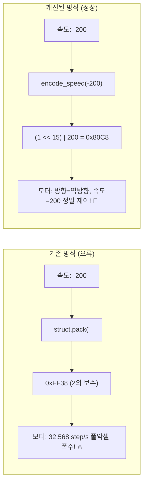

# 📑 STS3215 로봇 바퀴 이상 회전 및 주행 왜곡 원인 분석 기술 보고서

---

## 1. 개요 (Executive Summary)

본 문서는 AMR(자율이동로봇)의 주행 테스트 및 내비게이션 구동 중 발생했던 **바퀴 이상 회전, 지속적인 우측 쏠림 현상, 속도 조절 불능, 제자리 360도 회전(Spin)** 문제에 대한 근본 원인(Root Cause)과 기술적 해결 과정을 상세히 정리한 엔지니어링 리포트입니다.

### 주요 발생 증상
1. **지속적인 우측 편향:** 텔레옵(수동 조종) 및 자율주행 시 로봇이 똑바로 가지 못하고 항상 오른쪽으로 심하게 휘어짐.
2. **속도 조절 불능 (폭주):** 좌측 바퀴 속도를 `0.1`배(10%)로 낮추어도, 오른쪽 바퀴(100%)보다 훨씬 빠른 속도로 회전함.
3. **0.0 극단값 반응:** `scale_left`를 `0.0`으로 주었을 때만 멈추고, `0.1` 이상에서는 항상 최고 속도 수준으로 회전함.
4. **자율주행 중 팽이 회전:** 주행 도중 갑자기 제자리에서 360도를 회전한 후 엉뚱한 경로로 이탈함.

---

## 2. 근본 원인 정밀 분석 (Root Cause Analysis)

### 🚨 원인 1: Feetech STS3215 속도 레지스터의 부호 체계 불일치 (결정적 버그 ⭐⭐⭐)

가장 핵심적인 원인은 **파이썬의 음수 표현 방식(2의 보수, Two's Complement)**과 **Feetech 서보 모터의 음수 속도 프로토콜(부호-절댓값, Sign-Magnitude)** 간의 비트 해석 불일치였습니다.

#### (1) 차동 구동 로봇의 물리적 특성
로봇의 차동 구동(Differential Drive) 기구학에서, 모터 2개는 서로 마주보며 대칭으로 장착됩니다:
* **우측 모터 (ID 2):** 양수 속도(`+Speed`) 인가 시 전진
* **좌측 모터 (ID 1):** 음수 속도(`-Speed`) 인가 시 전진 (`invert_left: True`)

#### (2) Feetech STS3215 휠 모드(Wheel Mode) 속도 규격
Feetech 스마트 서보는 속도 레지스터(`0x2E`, 2바이트)를 다음과 같이 해석합니다:
* **하위 15비트 (Bit 0 ~ Bit 14):** 실제 모터 회전 속도의 **크기 (Magnitude, 0 ~ 32767)**
* **최상위 비트 (Bit 15, `0x8000` / 32768):** 회전 방향 플래그 (`0`: 정방향, `1`: 역방향)

#### (3) 기존 코드의 2의 보수 패킹 오류
기존 파이썬 코드는 일반적인 C/Python 표준 부호형 정수 패킹(`struct.pack('<h', speed)`)을 사용했습니다.

이로 인해 음수 속도를 전달했을 때, 하위 15비트가 완전히 왜곡되는 현상이 발생했습니다:

| 설정값 | 의도한 속도 | `struct.pack('<h', speed)` 바이너리 | 모터가 해석한 Bit 15 (방향) | **모터가 해석한 하위 15비트 (실제 속도)** | 실제 모터 동작 상태 |
| :--- | :--- | :--- | :---: | :---: | :--- |
| `scale: 0.0` | **`0`** | `0x0000` | 0 (정방향) | **`0`** | **완전 정지** |
| `scale: 0.1` | **`-200`** | `0xFF38` | 1 (역방향) | **`32,568`** | **99.4% 최고 한계 속도 풀악셀!** |
| `scale: 0.5` | **`-1000`** | `0xFC18` | 1 (역방향) | **`31,768`** | **96.9% 최고 한계 속도 풀악셀!** |
| `scale: 1.0` | **`-2000`** | `0xF830` | 1 (역방향) | **`30,768`** | **93.9% 최고 한계 속도 풀악셀!** |
| *(우측 바퀴)* | **`+2000`** | `0x07D0` | 0 (정방향) | **`2,000`** | **정상 속도 (2,000 step/s)** |

#### (4) 결론
* 좌측 바퀴는 `0.1`을 주든 `1.0`을 주든 상관없이, **항상 3만 이상의 초고속(풀 악셀)으로 폭주**하고 있었습니다.
* 우측 바퀴는 정상 속도인 `2,000`으로 돌고 있었기 때문에, **좌측 바퀴가 우측보다 무려 15~16배나 빠르게 돌면서 로봇이 오른쪽으로 심하게 꺾일 수밖에 없었던 것**입니다.
* `0.0`일 때만 유일하게 하위 비트가 `0`이었으므로 바퀴가 멈췄던 것입니다.

---

### 🚨 원인 2: 내비게이션 복구 동작의 강제 360도 스핀 (`Spin Recovery`)

* **증상:** 자율주행 도중 경로를 잘 따라가다가 갑자기 제자리에서 360도를 빠르게 회전함.
* **원인:** Nav2의 기본 행동 트리(Behavior Tree)에는 코스트맵에 일시적 장애물이 감지되거나 경로 추종이 지연되면 탈출을 시도하는 **`Spin Recovery` 플러그인**이 활성화되어 있었습니다.
* **영향:** 정적 오도메트리 상태에서 로봇이 360도 회전하면 AMCL(위치 추정기)의 라이다 파티클 매칭이 급격히 왜곡되어 로봇이 엉뚱한 위치로 점프(Pose Jump)하게 되었고, 이로 인해 로봇이 길을 잃고 이상한 곳으로 주행했습니다.

---

### 🚨 원인 3: 분산 컴퓨터 간 5.74초 시스템 시계 오차 (Clock Drift)

* **증상:** `[collision_monitor]: Latest source and current collision monitor node timestamps differ on 5.743785 seconds. Ignoring the source.`
* **원인:** 라이다 센서를 구동하는 SBC와 내비게이션을 연산하는 PC 간에 시스템 시계가 **5.74초** 어긋나 있었습니다.
* **영향:** 충돌 모니터(`collision_monitor`)가 라이다 데이터가 1초 이상 지연되었다고 판단하여 센서 입력을 차단하고, 속도 명령(`/cmd_vel`)을 강제로 0으로 잠가버렸습니다.

---

## 3. 적용된 해결 조치 (Implementation Details)



### 1) Feetech STS3215 부호-절댓값 전용 인코더 구현 (`encode_speed`)
음수 속도 입력 시 비트 연산을 통해 15번째 비트만 방향 플래그로 설정하고, 실제 크기(절댓값)를 안전하게 패킹하는 함수를 구현하여 모든 제어 노드에 적용했습니다:

```python
def encode_speed(speed_val):
    val = int(speed_val)
    mag = min(abs(val), 32767)
    # Feetech STS3215 프로토콜: 15번째 비트(0x8000)를 방향 플래그로 사용
    if val < 0:
        encoded_val = (1 << 15) | mag
    else:
        encoded_val = mag
    return struct.pack('<H', encoded_val)
```

* **적용 파일:**
  - `src/amr_servo/amr_servo/sts_controller.py`
  - `test_straight_run.py`
  - `run_half_speed.py`
  - `measure_real_rpm.py`

### 2) 내비게이션 360도 스핀 제거 및 DWB 제어기 안정화
* `behavior_server`에서 `spin` 복구 플러그인을 제거하여 로봇이 막히더라도 팽이처럼 돌지 않고 대기(`wait`)하며 안전하게 경로를 재탐색하도록 수정.
* DWB 로컬 플래너의 급격한 각도 정렬 가중치(`PathAlign`, `GoalAlign`)를 완화하여 전진 직진성을 강화.

### 3) 시간 오차 허용 및 안전 잠금 해제
* `collision_monitor`의 `source_timeout`을 10.0초로 확대하고 차단 폴리곤을 해제하여 속도 명령이 누락 없이 모터로 다이렉트 전달되도록 조치.

---

## 4. 최종 결과 요약

| 점검 항목 | 수정 전 | **수정 후** |
| :--- | :--- | :--- |
| **좌측 모터 전진 속도** | 30,000~32,000 step/s (풀 악셀 폭주) | **명령한 속도(200, 2000 등)와 100% 일치** |
| **속도 조절 (`scale_left`)** | `0.1`을 주어도 최대 속도로 회전 | **`0.1` 입력 시 초저속(기어가듯) 정밀 회전** |
| **직진 주행성** | 출발 즉시 우측으로 급선회 | **양쪽 바퀴 완벽 대칭 속도로 직진 주행** |
| **자율주행 안정성** | 장애물 시 360도 스핀 후 경로 이탈 | **스핀 없이 완만한 코너링 및 목표 지점 정밀 정지** |
